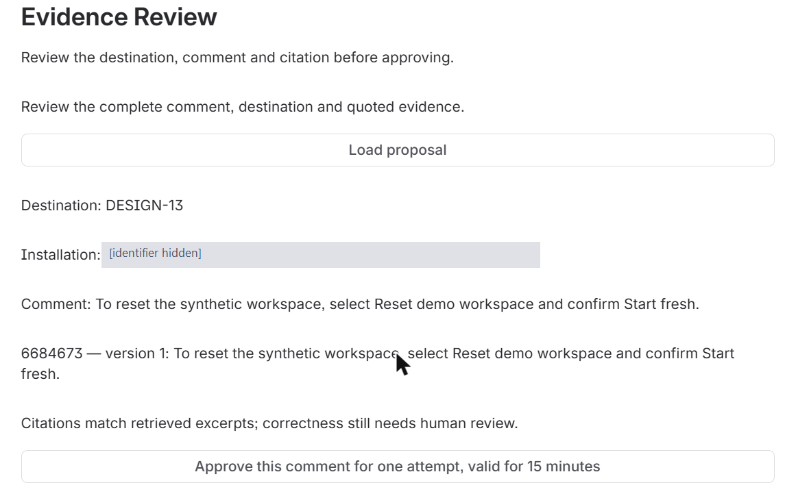
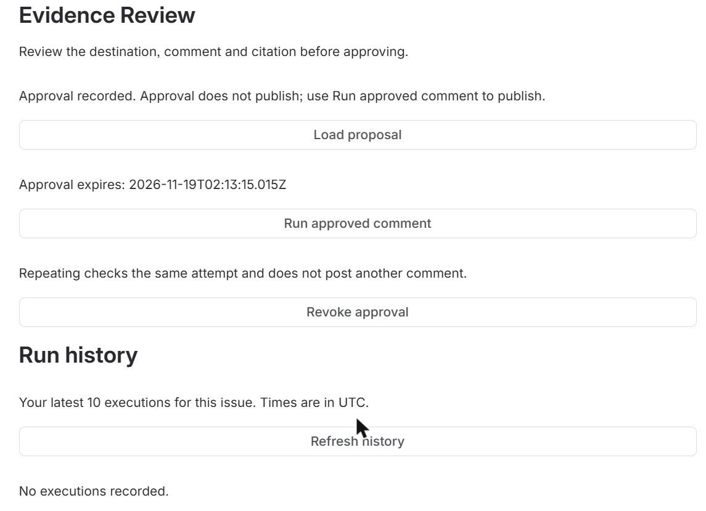
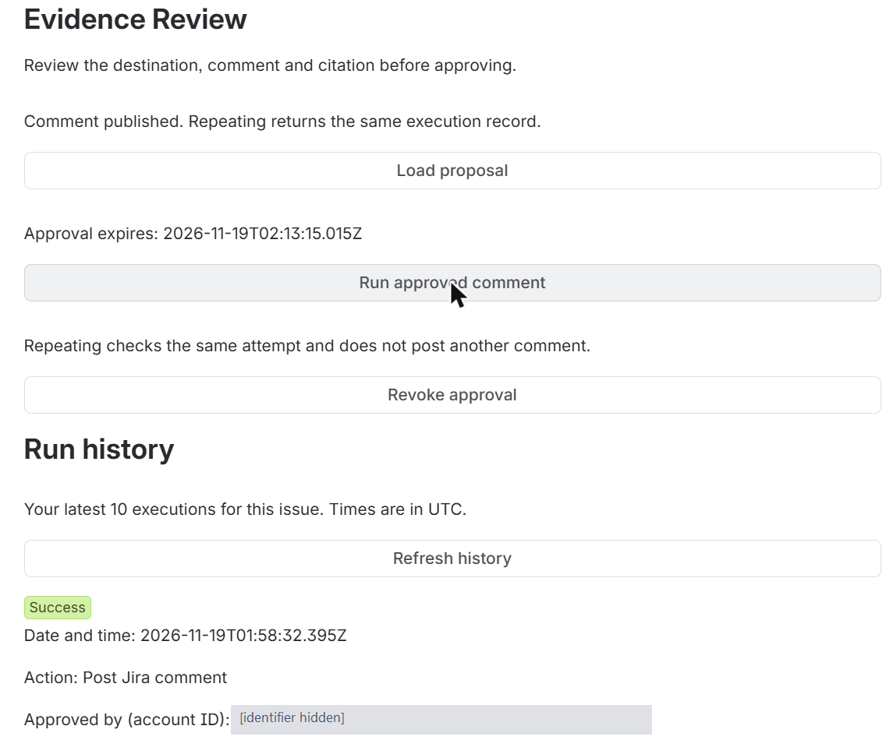
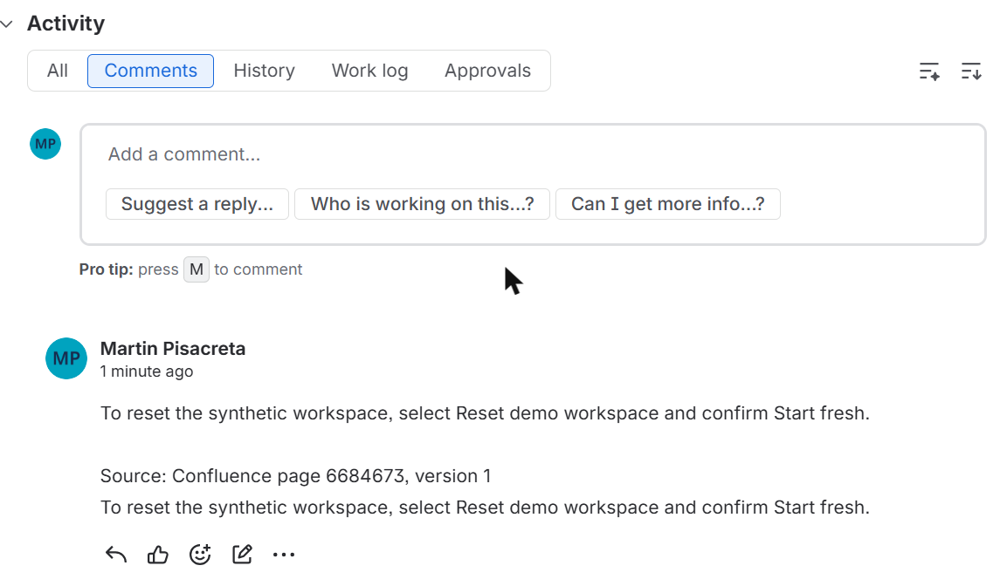

# Evidence Review

Evidence Review is an Atlassian Forge app built for Codegeist 2026. A Rovo agent collects evidence from Confluence and prepares a Jira comment that cites the exact page, version and quote. Nothing is published until a person reviews the destination, comment and citation in the issue panel and approves one attempt.

**Demo video (3:26):** https://youtu.be/x6fWbFeRvg8 — a complete run on a development site with synthetic records, recorded on 13 November 2026.

- Before approval: the issue panel shows the canonical draft and its citation.
- Approval is bound to the user, the installation, the issue and the draft, and it expires after 15 minutes.
- After approval, the same panel has a separate **Run approved comment** button. Approving never publishes; the button publishes once, and repeating it, also after a page reload, returns the same execution record without another comment.
- Execution re-checks the evidence before posting; changed, expired, revoked or already used approvals are rejected without posting.
- Related Confluence pages can be found through the Teamwork Graph API (Forge Preview).

**How it differs from built-in options.** Atlassian documents that [Rovo agents ask for confirmation before consequential tools](https://support.atlassian.com/rovo/docs/agent-actions/) and that [Jira Service Management AI answers](https://support.atlassian.com/jira-service-management-cloud/docs/atlassian-intelligence-answers-in-the-virtual-agent/) reply automatically in connected channels once activated (read 11 Nov 2026). Evidence Review adds a reviewable link between each proposed comment and the exact Confluence version and quote it relies on, with a single-use, expiring approval. We have not tested the alternatives, so we do not claim exclusivity.

**Judge walkthrough.** [JUDGE-WALKTHROUGH.md](JUDGE-WALKTHROUGH.md) has eight steps with synthetic material and exact prompts: collect, prepare, review, approve, publish, repeat, reload and inspect the run history. It states what was run on a development installation on 18 November 2026, the one run made on the production build on 19 November 2026, and what was not checked. The demo video predates the Run approved comment button: in it, publication goes through the MCP tool.

**What the panel looks like.** Four captures of the Jira issue panel on a synthetic issue, taken on 19 November 2026 on a development installation (version 3.9.0). The images are cropped to the panel, and two identifiers (the site and the approving account) are covered.

1. The stored draft after **Load proposal**: destination, comment, and the cited page with its version.

   

2. After approving: the approval has an expiry and does not publish by itself.

   

3. After **Run approved comment**: the result message and one Success row in Run history.

   

4. The Jira comment that was posted, with its source page and version.

   

**Source code.** The app source and its local tests are in [app/](app/). The tests need no Atlassian account and no installed dependencies: with Node 22, run `node --test` inside that folder (159 tests as of 20 November 2026). Two identifiers tied to the author's app registration are replaced by placeholders, as [app/README.md](app/README.md) explains.

**Skill for third-party agents.** [skills/evidence-review/SKILL.md](skills/evidence-review/SKILL.md) (MIT) tells an agent connected to the Atlassian MCP server how to use the app's four MCP tools: collect the Confluence evidence, prepare the cited draft, leave approval to a person in the Jira issue panel, then execute once with a stable idempotency key and check the posted comment.

This repository holds the app's public policies and the support channel:

- [Privacy policy](PRIVACY.md)
- [Terms of use](TERMS.md)
- [Support](SUPPORT.md): use this repository's [issue tracker](../../issues).

The app is intended for test sites with synthetic data.
